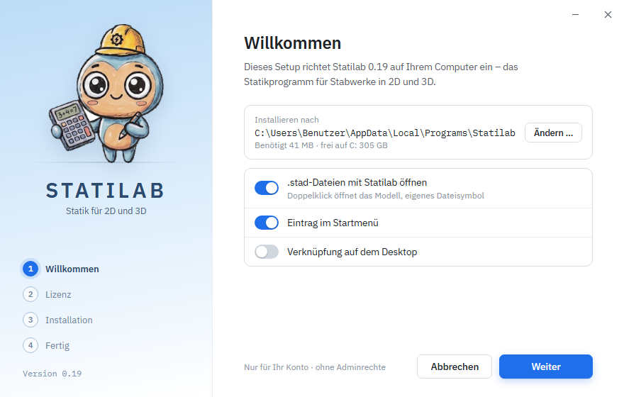
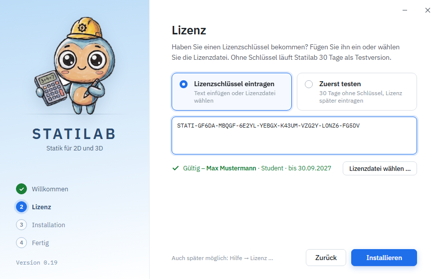
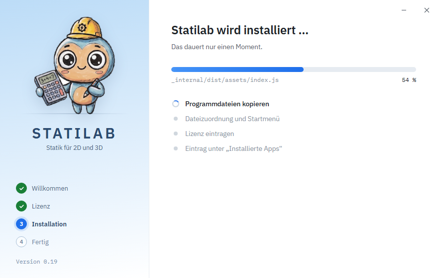
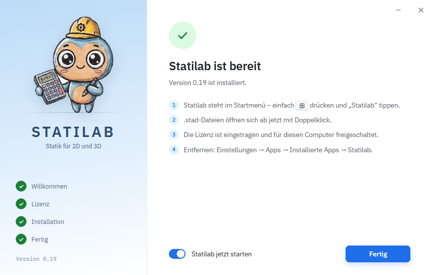
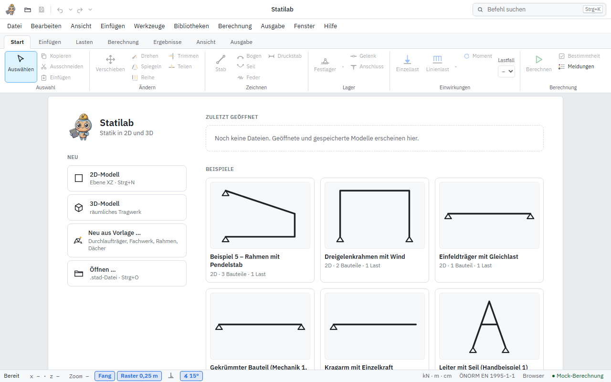
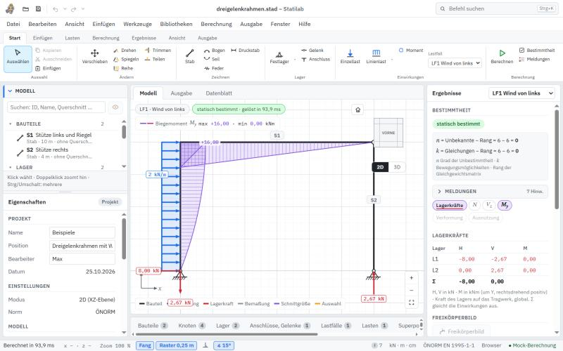

# Statilab unter Windows installieren

Für **Windows 10 und 11**. Dauer: ca. 2–5 Minuten. Es braucht **keine Administratorrechte** – Statilab wird nur für das eigene Benutzerkonto installiert.

[← zurück zur Übersicht](README.md)

---

## 1. Setup herunterladen

Auf der Seite **[Releases → neueste Version](https://github.com/Rusty-123/Statilab-Installer/releases/latest)** unter *Assets* auf **`Statilab-Setup.exe`** klicken (ca. 50 MB).

Oder direkt: **[Statilab-Setup.exe herunterladen](https://github.com/Rusty-123/Statilab-Installer/releases/latest/download/Statilab-Setup.exe)**

> Fragt der Browser nach („Diese Datei wird selten heruntergeladen …“): **Behalten** wählen.

## 2. Setup starten

Im Download-Ordner **doppelklicken** auf `Statilab-Setup.exe`.

**Windows SmartScreen:** Weil das Setup (noch) nicht digital signiert ist, zeigt Windows beim ersten Mal ein blaues Fenster *„Der Computer wurde durch Windows geschützt“*.

| Schritt | Klick |
|---|---|
| 1 | **Weitere Informationen** (kleiner Link unter dem Text) |
| 2 | **Trotzdem ausführen** |

Danach erscheint sofort dieses kleine Startbild:

> **Beim ersten Start dauert es etwas.** Windows Defender prüft die Datei, bevor das Setup weitermachen darf. Das kann **bis zu 2 Minuten** dauern, in denen nur das Startbild zu sehen ist. Bitte warten.
> Verschwindet das Startbild, ohne dass etwas kommt, oder passiert gar nichts: das Setup **einfach noch einmal starten** und etwas warten. Beim zweiten Mal geht es schnell.

## 3. Willkommen

Hier lässt sich der Zielordner ändern (vorgeschlagen ist `C:\Users\<Name>\AppData\Local\Programs\Statilab`, das passt meistens). Die Schalter legen fest, ob `.stad`-Dateien mit Statilab geöffnet werden und ob es eine Verknüpfung im Startmenü bzw. auf dem Desktop gibt.

→ **Weiter**

## 4. Lizenz

| Sie haben … | dann |
|---|---|
| einen **Lizenzschlüssel** (Text, beginnt mit `STATI-`) | ins Feld einfügen (Strg+V) |
| eine **Lizenzdatei** | **Lizenzdatei wählen …** und die Datei aussuchen |
| noch nichts | **Zuerst testen** – Statilab läuft 30 Tage als Testversion, die Lizenz lässt sich später unter *Hilfe → Lizenz …* eintragen |

Der Schlüssel wird sofort geprüft. Ist er gültig, erscheint ein grüner Haken mit Name und Ablaufdatum.

→ **Installieren**

## 5. Installation

Das Setup kopiert die Programmdateien und richtet Startmenü und Dateizuordnung ein. Das dauert nur einige Sekunden.

## 6. Fertig

Mit eingeschaltetem **Statilab jetzt starten** → **Fertig** öffnet sich das Programm gleich.

## 7. So sieht Statilab nach dem Start aus

Zuerst kurz das Ladebild, danach die Startseite: links **Neu** (2D- oder 3D-Modell, Vorlage, Öffnen), rechts zuletzt geöffnete Dateien und **Beispiele** zum Ausprobieren.

Ein Klick auf ein Beispiel öffnet es, **Berechnen** (oder F5) zeigt die Ergebnisse – hier der Dreigelenkrahmen mit Wind:

**Später wieder öffnen:** Windows-Taste drücken, „Statilab“ tippen, Enter.

---

## Wenn etwas nicht klappt

| Problem | Lösung |
|---|---|
| Nach dem Doppelklick passiert nichts / das Startbild bleibt lange stehen | bis zu 2 Minuten warten (Virenprüfung beim ersten Start). Danach das Setup noch einmal starten. |
| „Der Computer wurde durch Windows geschützt“ | **Weitere Informationen → Trotzdem ausführen** |
| „Statilab ist noch geöffnet …“ | alle Statilab-Fenster schließen, dann **Nochmals versuchen** |
| Lizenzschlüssel wird als ungültig gemeldet | Schlüssel vollständig kopieren (beginnt mit `STATI-`), oder **Lizenzdatei wählen …** verwenden |
| Fenster bleibt leer oder weiß (selten, ältere Windows-10-Rechner) | die *Microsoft Edge WebView2 Runtime* fehlt: bei Microsoft „WebView2 Runtime“ suchen, den *Evergreen Bootstrapper* installieren, Statilab neu starten |

## Aktualisieren

Gibt es eine neue Version, meldet Statilab das beim Start. **Jetzt aktualisieren** lädt sie, installiert sie und startet Statilab neu – Lizenz, Einstellungen und Modelle bleiben erhalten. Von Hand geht es auch: einfach das neue Setup herunterladen und ausführen.

## Entfernen

*Einstellungen → Apps → Installierte Apps → Statilab → ⋯ → Deinstallieren*. Eigene Modelle (`.stad`-Dateien) bleiben dabei unverändert.
