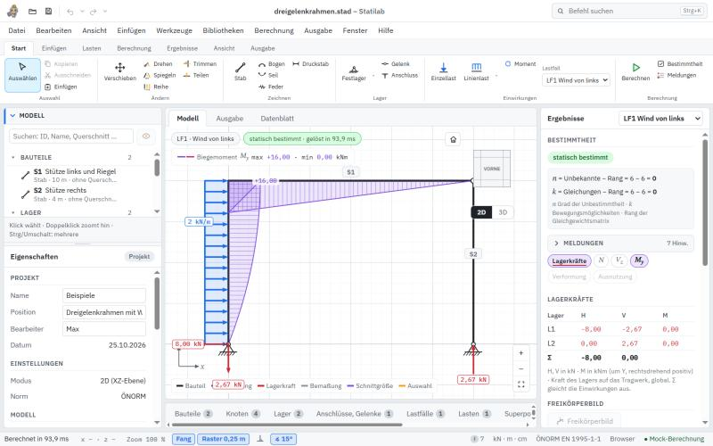

  

<b>Statikprogramm für ideale Statik in 2D und 3D</b> 
Stabwerke, Gelenksysteme, Seile über Rollen und Starrkörper – auf Deutsch, nach ÖNORM.

  <a href="https://github.com/Rusty-123/Statilab-Installer/releases/latest"><b>⬇ Neueste Version herunterladen</b></a>
  &nbsp;·&nbsp;
  <a href="ANLEITUNG_WINDOWS.md"><b>Installationsanleitung Windows</b></a>

---

## Was ist Statilab?

Statilab ist ein Statikprogramm, das ich (Student Maschinenbau und Bauingenieurwesen an der TU Wien, HTL Hochbau/Holzbau) selbst entwickle. Man zeichnet Bauteile wie Träger, Stützen, Sparren, Seile oder Rollen, setzt Lager und Lasten – und Statilab zeigt Bestimmtheit, Lagerkräfte und Schnittgrößen.

  

| | |
|---|---|
| **Systeme** | Träger, Rahmen, Fachwerke, Gerberträger, Dreigelenkrahmen, gekrümmte Bauteile, Seile über Rollen, Zylinder und Quader als Starrkörper – in 2D und 3D |
| **Bedienung** | Bauteile zeichnen wie im CAD (Fang, Raster, Ortho, Bemaßung), Gelenke und Federn am Anschluss, Rückgängig/Wiederholen, Befehlssuche mit Strg+K |
| **Lasten** | Einzelkraft, Einzelmoment, Trapezlast, Lastfälle, Überlagerung und Umhüllende |
| **Ergebnisse** | Bestimmtheit über den Rang der Gleichgewichtsmatrix, Lagerkräfte, N/V/M-Verläufe, Freikörperbild |
| **Ausgabe** | bearbeitbarer Bericht im A4-Format, Datenblatt je Bauteil, PDF |
| **Darstellung** | Einwirkungen blau, Lagerkräfte rot, Schnittgrößen violett – Lagersymbole und Vorzeichen wie im Skript |

> **Entwicklungsstand:** Die Oberfläche ist weit fortgeschritten, der eigene Rechenkern ist noch im Aufbau. Bis er fertig ist, rechnet Statilab die mitgelieferten Beispiele mit hinterlegten Ergebnissen vor. Neue Versionen meldet das Programm beim Start selbst und installiert sie auf Wunsch direkt.

## Herunterladen

Alle Dateien liegen unter **[Releases](https://github.com/Rusty-123/Statilab-Installer/releases/latest)** (der Link führt immer zur neuesten Version).

| System | Datei |
|---|---|
| **Windows 10 / 11** | `Statilab-Setup.exe` – [direkt herunterladen](https://github.com/Rusty-123/Statilab-Installer/releases/latest/download/Statilab-Setup.exe) |
| Ubuntu 24.04+, Linux Mint 22, Debian 13 | `statilab_<Version>_all.deb` |
| andere Linux-Systeme (z. B. Ubuntu 22.04) | `Statilab-<Version>-x86_64.AppImage` |

## Installieren unter Windows – kurz

1. **`Statilab-Setup.exe`** herunterladen und doppelklicken.
2. Zeigt Windows „Der Computer wurde durch Windows geschützt“: **Weitere Informationen → Trotzdem ausführen** (das Setup ist noch nicht digital signiert).
3. Beim **ersten Start** kann es bis zu **2 Minuten** dauern, bis das Setup-Fenster erscheint – Windows prüft die Datei vorher. Erscheint gar nichts, das Setup einfach noch einmal starten und etwas warten.
4. Im Setup **Weiter** → Lizenzschlüssel einfügen oder Lizenzdatei wählen (ohne Schlüssel: 30 Tage Testversion) → **Installieren** → **Fertig**.

Keine Administratorrechte nötig. Statilab steht danach im Startmenü, `.stad`-Dateien öffnen sich mit Doppelklick.

👉 **Ausführlich mit Bildern: [ANLEITUNG_WINDOWS.md](ANLEITUNG_WINDOWS.md)**

## Installieren unter Linux – kurz

- **.deb:** Datei doppelklicken (Softwareverwaltung) oder `sudo apt install ./statilab_<Version>_all.deb`
- **AppImage:** ausführbar machen (`chmod +x Statilab-*.AppImage`) und starten

## Entfernen

Windows: *Einstellungen → Apps → Installierte Apps → Statilab → Deinstallieren*. Eigene Modelle (`.stad`) bleiben erhalten.

---

Dieses Repository enthält nur die Installationsdateien, der Quellcode ist privat. Statilab ist ein privates Projekt und keine geprüfte Statiksoftware – Ergebnisse bitte immer mit Handrechnung oder einem zweiten Programm kontrollieren.
