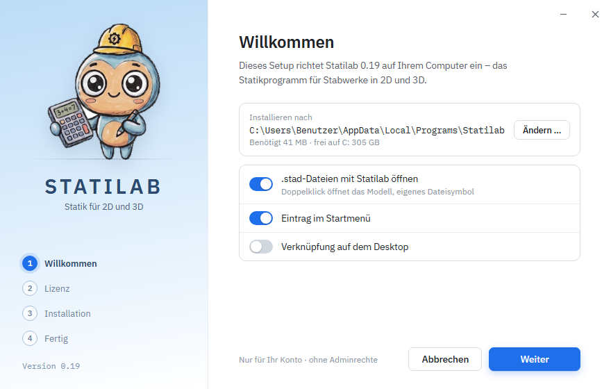
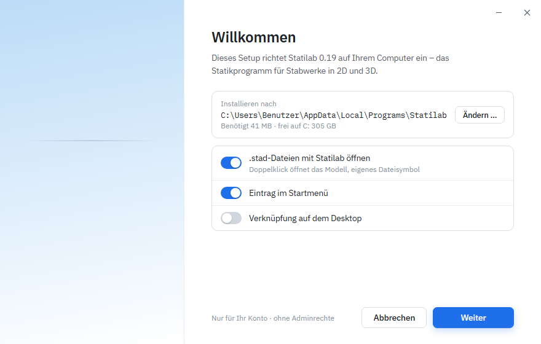
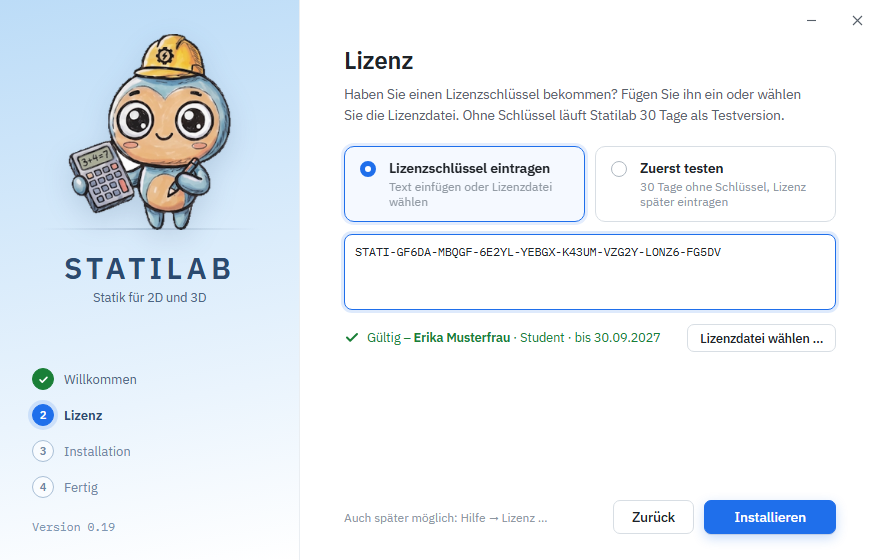
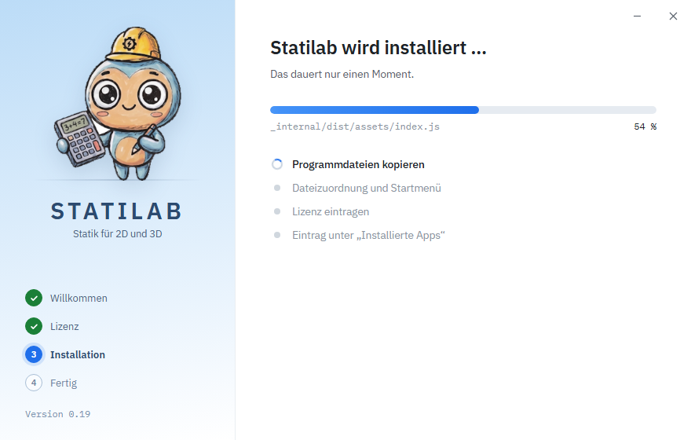
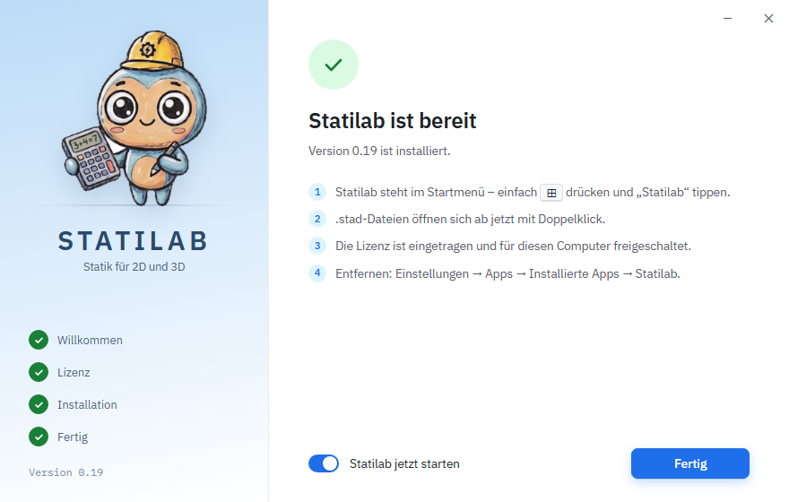

# Statilab installieren – Setup-Anleitung

Für **Windows 10 und 11**. Dauer: ca. 2–5 Minuten. Es werden **keine Administratorrechte** benötigt – Statilab wird für das eigene Benutzerkonto installiert.

[← zurück zur Übersicht](README.md)

---

## 1. Setup herunterladen

Auf der Seite **[Releases → neueste Version](https://github.com/Rusty-123/Statilab-Installer/releases/latest)** unter *Assets* auf **`Statilab-Setup.exe`** klicken (ca. 50 MB).

Oder direkt: **[Statilab-Setup.exe herunterladen](https://github.com/Rusty-123/Statilab-Installer/releases/latest/download/Statilab-Setup.exe)**

> Fragt der Browser nach („Diese Datei wird selten heruntergeladen …“): **Behalten** wählen.

## 2. Setup starten

Im Download-Ordner auf `Statilab-Setup.exe` **doppelklicken**.

**Windows SmartScreen:** Da das Setup (noch) nicht digital signiert ist, zeigt Windows beim ersten Mal das Fenster *„Der Computer wurde durch Windows geschützt“*.

| Schritt | Klick |
|---|---|
| 1 | **Weitere Informationen** (Link unter dem Text) |
| 2 | **Trotzdem ausführen** |

Danach erscheint dieses Startbild:

> **Beim ersten Start dauert es etwas.** Windows Defender prüft die Datei, bevor das Setup startet. Das kann **bis zu 2 Minuten** dauern. Bitte warten.

## 3. Willkommen

Der Zielordner kann geändert werden (Vorschlag: `C:\Users\<Name>\AppData\Local\Programs\Statilab`). Die Schalter legen fest, ob `.stad`-Dateien mit Statilab geöffnet werden und ob eine Verknüpfung im Startmenü bzw. auf dem Desktop angelegt wird.

→ **Weiter**

> [!WARNING]
> **Setup bleibt hängen:** Manchmal erscheint die Willkommen-Seite **unvollständig**. Die linke Seite zeigt nur den hellblauen Hintergrund – ohne Figur, Schriftzug und Schrittliste – und das Setup reagiert nicht mehr (siehe Bild unten).
>
> **Lösung:** Das Setup-Fenster schließen (falls nötig über den Task-Manager: *Strg + Umschalt + Esc* → „Statilab-Setup“ → *Task beenden*) und `Statilab-Setup.exe` **erneut starten**. Beim zweiten Start läuft es normal durch.

## 4. Lizenz

| Vorhanden | Vorgehen |
|---|---|
| **Lizenzschlüssel** (Text, beginnt mit `STATI-`) | ins Feld einfügen (Strg+V) |
| **Lizenzdatei** | **Lizenzdatei wählen …** und die Datei auswählen |
| keine Lizenz | **Zuerst testen** – Statilab läuft 30 Tage als Testversion; die Lizenz kann später unter *Hilfe → Lizenz …* eingetragen werden |

Der Schlüssel wird sofort geprüft. Ist er gültig, erscheint ein grüner Haken mit Name und Ablaufdatum.

→ **Installieren**

## 5. Installation

Das Setup kopiert die Programmdateien und richtet Startmenü und Dateizuordnung ein. Das dauert nur wenige Sekunden.

## 6. Fertig

Die Installation ist abgeschlossen. Mit eingeschaltetem **Statilab jetzt starten** → **Fertig** wird das Programm direkt geöffnet. Später: Windows-Taste drücken, „Statilab“ eingeben, Enter.

---

## Fehlerbehebung

| Problem | Lösung |
|---|---|
| Nach dem Doppelklick passiert nichts oder das Startbild bleibt lange stehen | bis zu 2 Minuten warten (Prüfung durch Windows Defender beim ersten Start), danach das Setup erneut starten |
| Willkommen-Seite links nur Hintergrund, Setup reagiert nicht | Setup schließen und erneut starten (siehe [Schritt 3](#3-willkommen)) |
| „Der Computer wurde durch Windows geschützt“ | **Weitere Informationen → Trotzdem ausführen** |
| „Statilab ist noch geöffnet …“ | alle Statilab-Fenster schließen, dann **Nochmals versuchen** |
| Lizenzschlüssel wird als ungültig gemeldet | Schlüssel vollständig kopieren (beginnt mit `STATI-`) oder **Lizenzdatei wählen …** verwenden |
